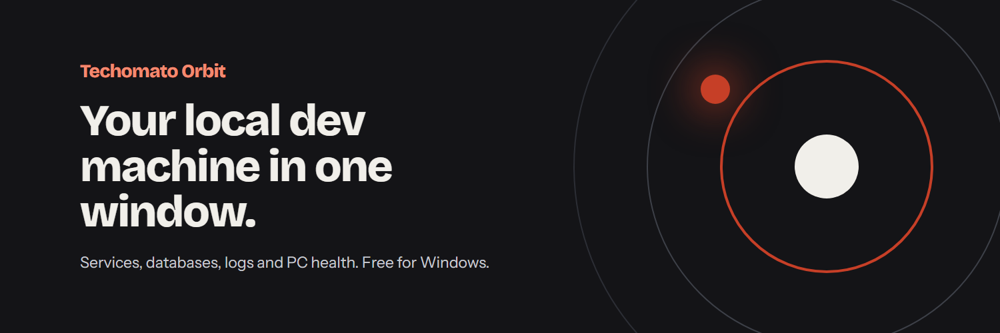
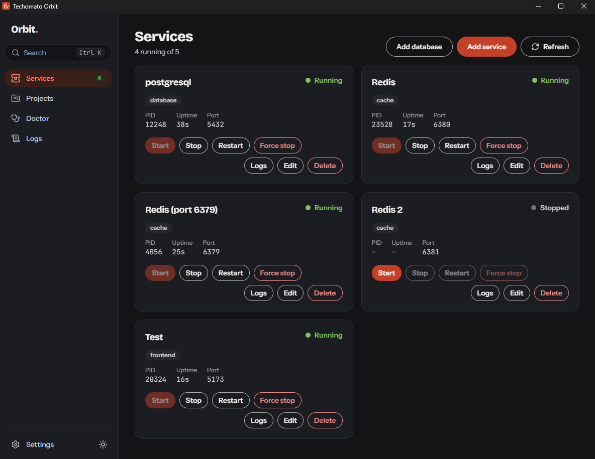

<div align="center">



# Techomato Orbit

[](https://github.com/KoushikMallik-developer/techomato-orbit/releases)
[](https://github.com/KoushikMallik-developer/techomato-orbit/releases/latest)
[](#license)

</div>

Techomato Orbit is a free, open-source Windows desktop app that manages your local development
environment. Start and stop dev servers and background services, run PostgreSQL, MariaDB, Redis and
MongoDB on your PC without Docker, follow live logs, see which ports are in use, group services into
projects, and check your PC's health, all from one window and the system tray. It works offline
after setup, except when downloading a database or checking for updates.

> **Windows 10 or 11 - 64-bit**



---

## Download and install

### Latest stable release - recommended

Use the stable build for the most reliable experience.

1. Open the **[Latest Stable Release](https://github.com/KoushikMallik-developer/techomato-orbit/releases/latest)** page.
2. Under **Assets**, download `Techomato Orbit_<version>_x64-setup.exe`.
3. Double-click the downloaded installer.
4. Choose **Install for me only** or **Install for all users**.
5. Launch **Techomato Orbit** from the Start menu.

> **Windows SmartScreen:** Orbit currently has no paid Windows publisher certificate. If Windows
> displays **Microsoft Defender SmartScreen protected your PC**, select **More info**, then
> **Run anyway**.

### Latest release version

Use this page to see every published version. The newest entry may be a prerelease.

1. Open the **[All Releases](https://github.com/KoushikMallik-developer/techomato-orbit/releases)** page.
2. Choose the newest release you want to use. A **Pre-release** label means it may be less stable.
3. Open **Assets** and download `Techomato Orbit_<version>_x64-setup.exe`, where `<version>` is the release you chose.
4. Run the installer and follow the on-screen instructions.

**MSI installer:** Organizations and managed PCs can use
`Techomato Orbit_<version>_x64_en-US.msi`. It is machine-wide and may require
administrator rights.

### Upgrade an existing installation

Open Orbit, go to **Settings > Updates**, and use **Check for updates**. Updates are signature
verified and are installed only after you confirm.

---

## What you can do

|               |                                                                                      |
| :------------ | :----------------------------------------------------------------------------------- |
| **Services**  | Start, stop, restart, monitor health, and view live logs for local services.         |
| **Databases** | Add PostgreSQL, MariaDB, Redis, or MongoDB with one click - no Docker required.      |
| **Projects**  | Group services and start or stop dependencies in the correct order.                  |
| **Ports**     | See the actual port used by every running service.                                   |
| **Doctor**    | Check drives, memory, caches, startup apps, power settings, WSL, Docker, and Ollama. |
| **Tray mode** | Close the window while Orbit stays available from the system tray.                   |

### Handy shortcuts

- Press **Ctrl+K** to open the command palette.
- Add global shortcuts from Settings.
- Configure notifications and start Orbit with Windows.

---

## Databases and local data

Orbit downloads databases once, verifies the download, and keeps the program and data under:

```text
%LOCALAPPDATA%\Techomato Orbit
```

Databases listen on this PC only and do not use passwords, so they are intended for development.
Deleting a database service removes its data. Uninstalling Orbit does not remove database files;
delete the folder above if you want to remove every database completely.

Orbit also discovers compatible databases already running on Windows, including Redis,
PostgreSQL, MySQL/MariaDB, and MongoDB.

---

## Questions people ask

**How do I run PostgreSQL, MariaDB, Redis or MongoDB on Windows without Docker?**
Use **Add database** in Orbit. It downloads the program once, checks it against a fixed checksum,
and adds a service that listens on this PC only. These databases have no password, so use them for
development only.

**How do I start my Django, Flask, FastAPI, Vite, Express or Node dev servers together?**
Add each as a service (templates fill in the form), then group them in a **Project**. Orbit starts
them in dependency order and stops them in reverse.

**How do I see which port my local server is really using on Windows?**
The Services page shows the port each running service is actually listening on.

**Can I control a Redis or database that is already running as a Windows service?**
Yes. Orbit finds running databases and shows them as ordinary cards you can start, stop and restart.
Windows service control asks for administrator rights each time.

**Is Techomato Orbit free?**
Yes. It is free and open source under the MIT licence.

---

## Build from source

### Prerequisites

- Node.js 22.12 or newer
- Rust with rustup
- Visual Studio C++ Build Tools
- Windows 10 or 11, 64-bit

### Development

```bash
npm ci
npm start
```

### Tests

```bash
npm test
cargo test --manifest-path src-tauri/Cargo.toml
```

### Build the Windows installers

```bash
npm run release
```

Installers are created under `src-tauri/target/release/bundle/`. The setup and release process is
documented in [docs/releasing.md](docs/releasing.md).

---

## Contributing, bugs and feature requests

Contributions are welcome, from a typo fix to a new feature.

- **Report a bug:** [open a bug report](https://github.com/KoushikMallik-developer/techomato-orbit/issues/new?template=bug_report.yml).
  Include your Orbit version (Settings > About), your Windows version and the steps to reproduce.
  Search [existing issues](https://github.com/KoushikMallik-developer/techomato-orbit/issues) first.
  Remove passwords, tokens and personal paths from screenshots and logs.
- **Suggest a feature:** [open a feature request](https://github.com/KoushikMallik-developer/techomato-orbit/issues/new?template=feature_request.yml).
  Say what you are trying to do before how you would like Orbit to do it.
- **Send a pull request:**
  1. [Fork](https://github.com/KoushikMallik-developer/techomato-orbit/fork) the repository and
     create a branch for your change.
  2. Set up and run the app as described in [Build from source](#build-from-source).
  3. Keep the change small and focused. For a large change, open an issue first so we can agree on
     the approach.
  4. Run `npm run typecheck`, `npm run lint`, `npm test` and
     `cargo test --manifest-path src-tauri/Cargo.toml`.
  5. [Open a pull request](https://github.com/KoushikMallik-developer/techomato-orbit/pulls) and fill
     in the template. For visible changes, add screenshots in light and dark mode.

Colours come only from the tokens in `src/styles/theme.css`. How the app fits together is in
[Architecture](docs/architecture.md).

## License

Techomato Orbit is free and open source under the [MIT License](LICENSE).
